# Screenshot tour

The whole product in the order a tax preparer meets it, following the Definition of done
(BUILD_PROMPT.md §8). Every image is captured by a test run, not mocked:
website screenshots by `pnpm screenshots` in `apps/web` (all routes at 375, 768 and 1440 px,
light and dark, in `screenshots/phase-1`), app screenshots by the desktop e2e run against the
release build (`screenshots/phase-3` to `phase-5`). The synthetic clients and companies are fake.

## 1–2. Find the site, understand it in ten seconds

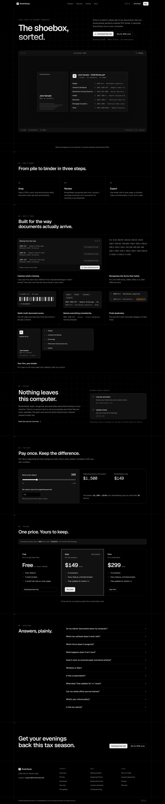

Pricing, the security overview and the docs:
[pricing](screenshots/phase-1/pricing-light-1440.jpg) ·
[security](screenshots/phase-1/security-dark-1440.jpg) ·
[getting started](screenshots/phase-1/docs-light-1440.jpg) ·
[review shortcuts](screenshots/phase-1/docs-review-shortcuts-light-1440.jpg) ·
[phone width](screenshots/phase-1/home-light-375.jpg)

## 3. Download the trial

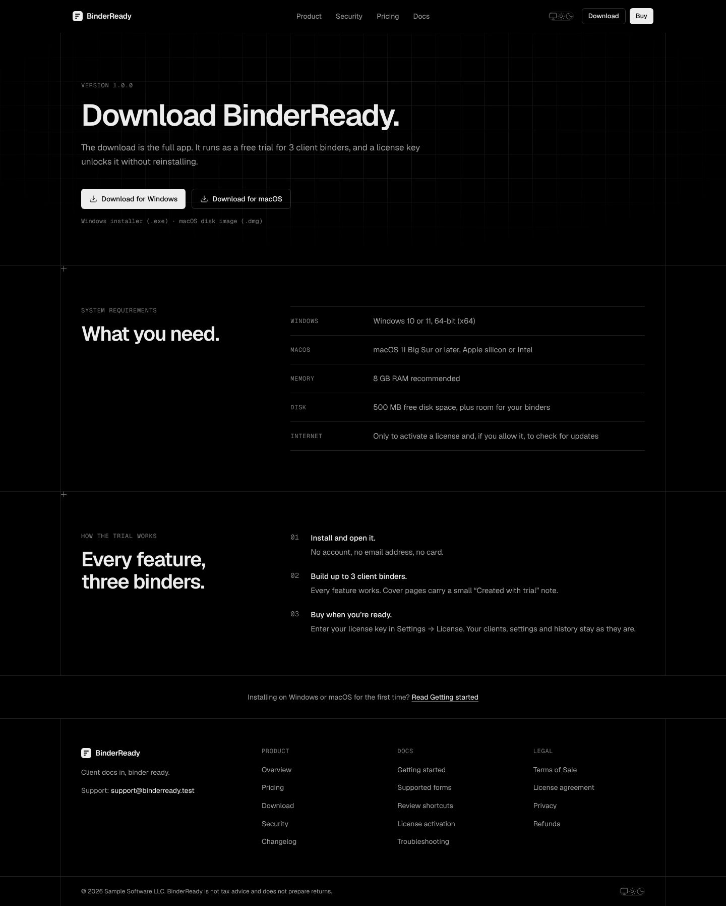

The buttons point at the newest published GitHub release (`DOWNLOAD_REPO`; unset in this
build, hence the marker).

## 4. Drop in a messy pile

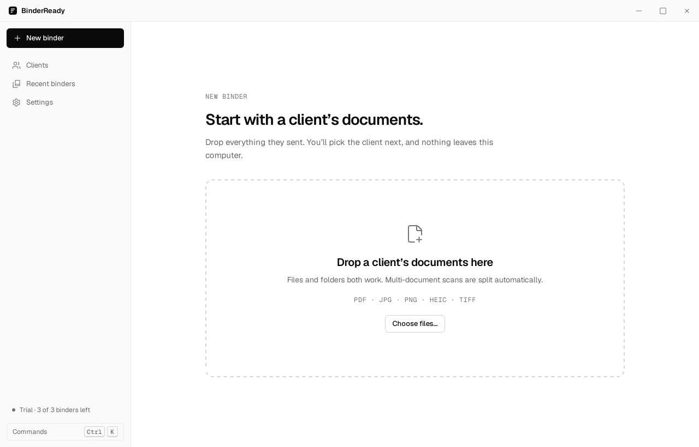
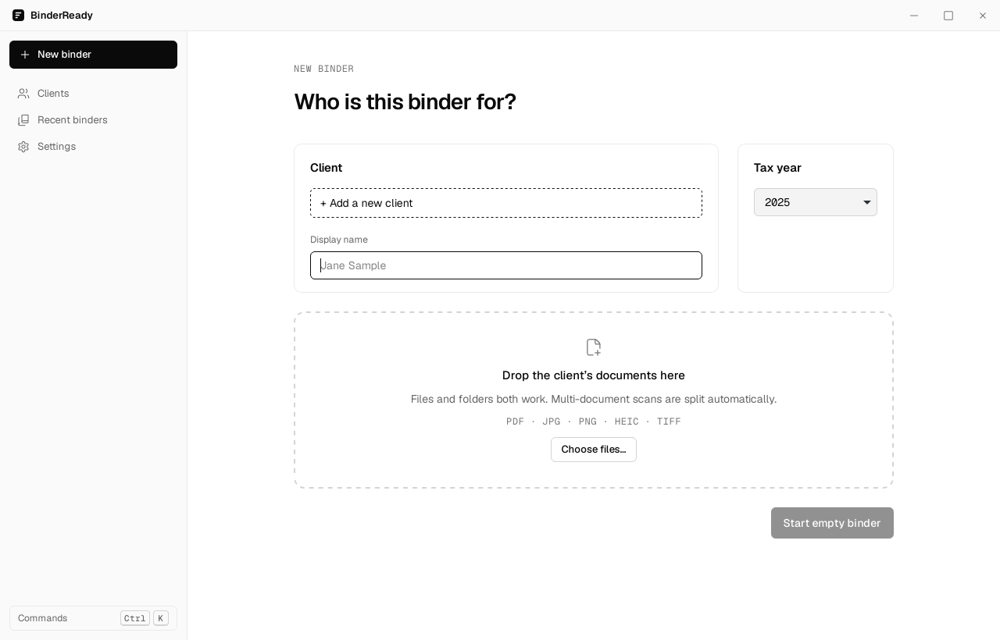
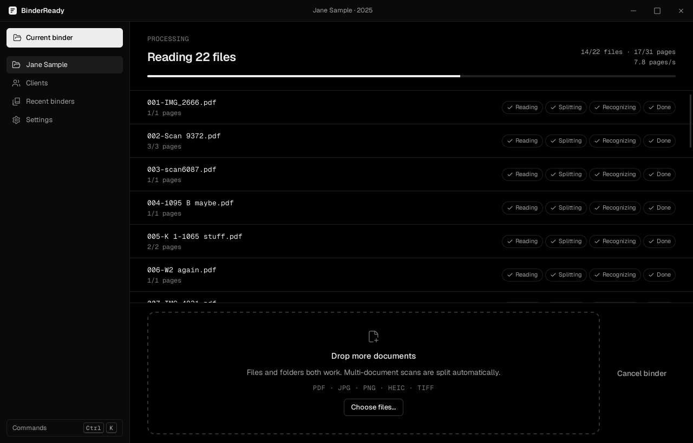

## 5. Fix flagged items with the keyboard

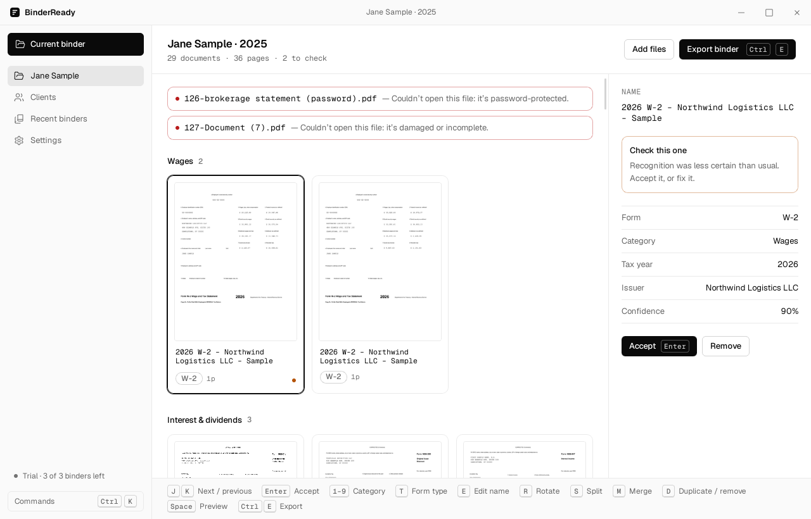

A password-protected and a damaged file get their own cards; the rest of the pile carries on.
[Form-type picker (T)](screenshots/phase-3/05-form-picker-light.png) ·
[preview (Space)](screenshots/phase-3/06-preview-light.png) ·
[page strip](screenshots/phase-3/07-page-strip-dark.png) ·
[command palette](screenshots/phase-3/08-command-palette-light.png) ·
[dark](screenshots/phase-3/04-review-dark.png)

## 6. Export a bookmarked binder

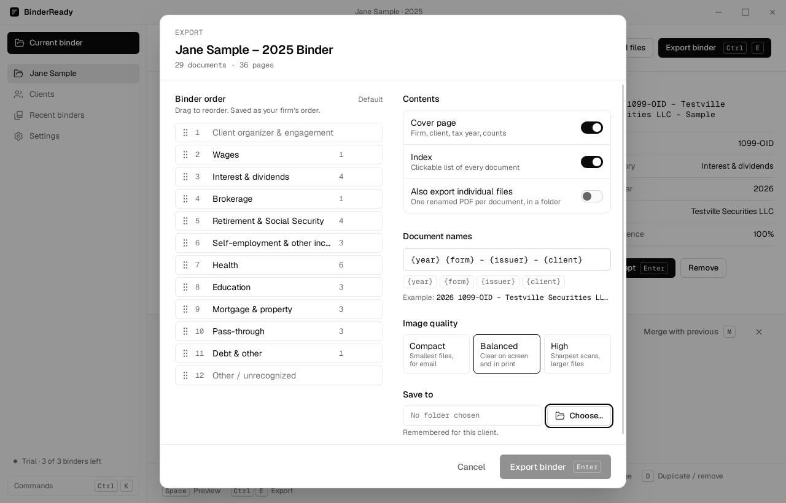
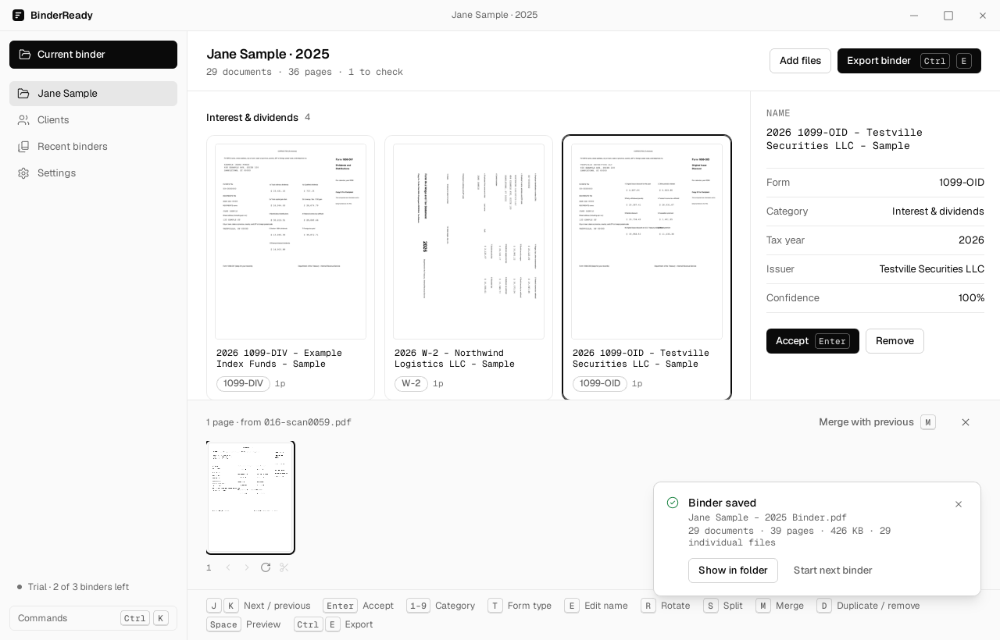

The binder itself, rendered from the exported PDF, with its bookmarks. Two things in it come
from the test, not the app: the second W-2 sits under Interest & dividends because the e2e moves
it there with key 3 to test re-filing, and the forms say 2026 because the synthetic corpus prints
that year while the binder is for tax year 2025.

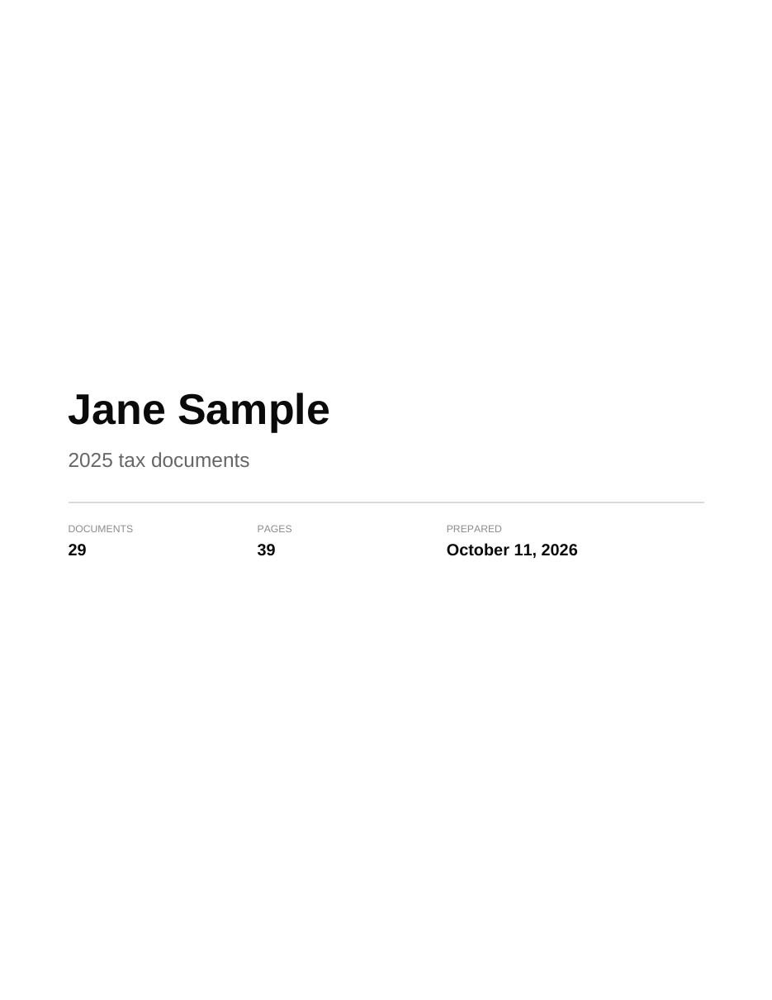
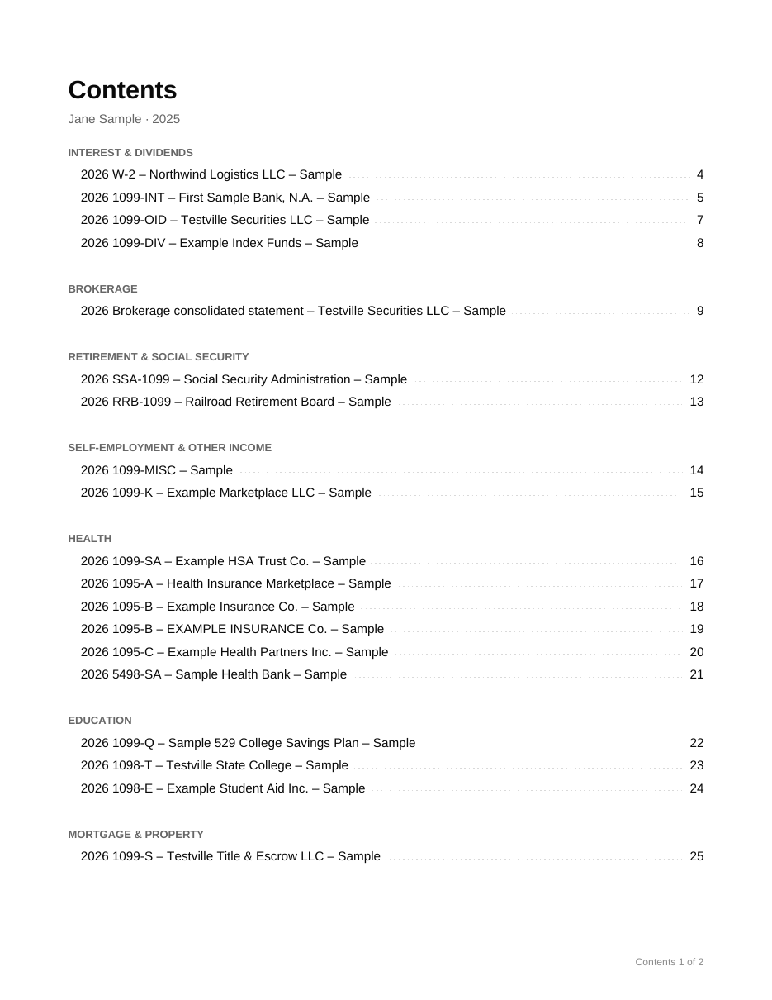
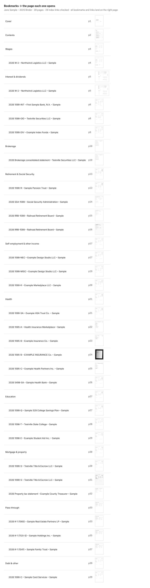

[Cover with a firm logo](screenshots/phase-5/04-cover-with-logo.png)

## 7. See what's missing from last year

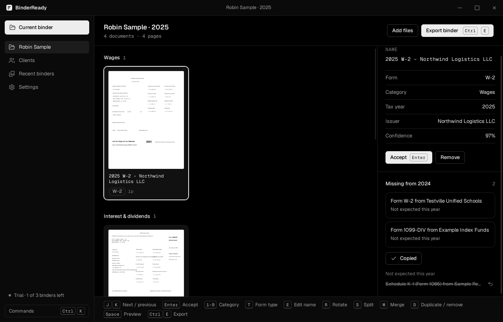
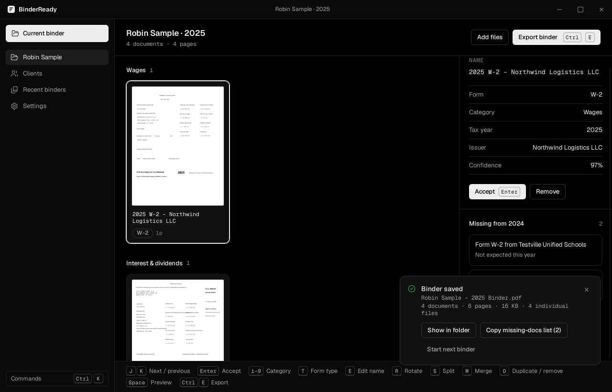

## 8–10. Buy, activate, keep working offline

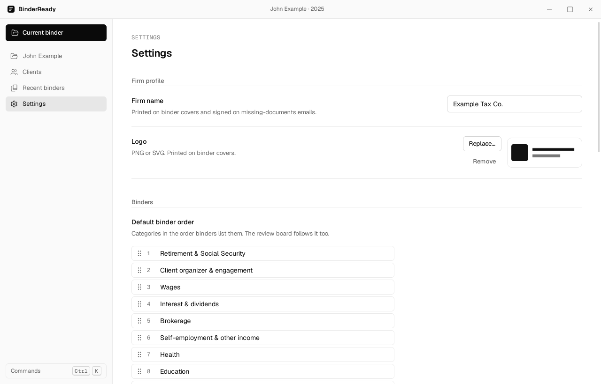
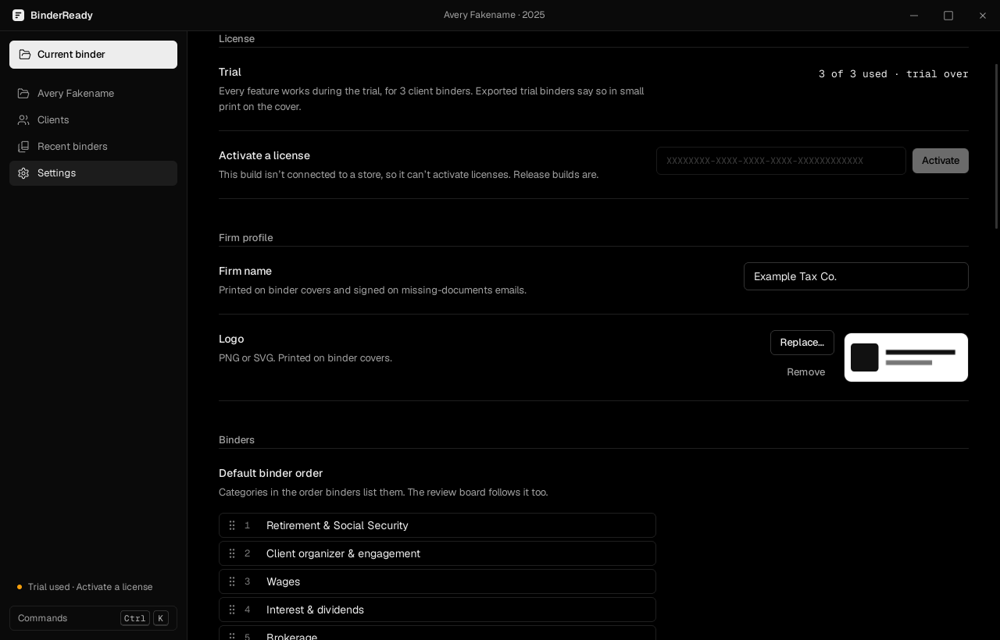
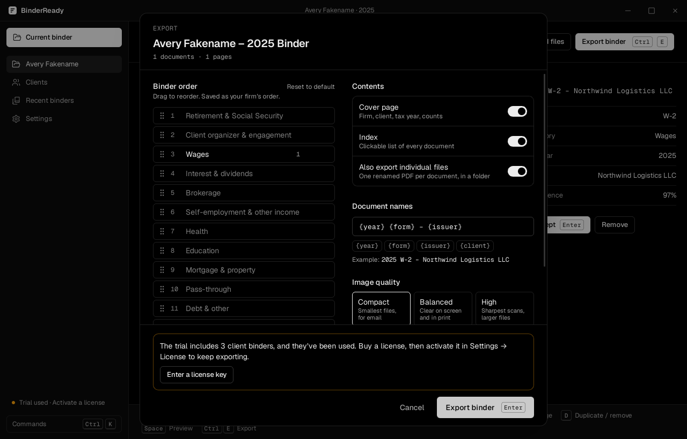

This build has no store configured, so activation is disabled and says why. Activation
against the live Lemon Squeezy API is on Corey's list (docs/launch-checklist.md).
